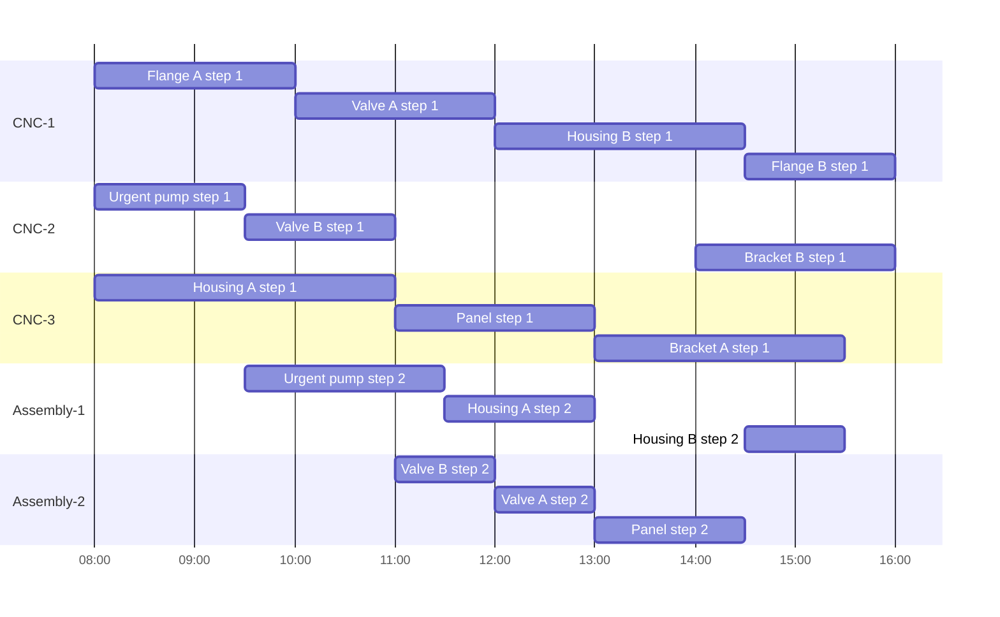

<!-- mcp-name: io.github.ArchiPlan-io/production-scheduling-mcp -->

# Production Scheduling MCP

[](https://pypi.org/project/production-scheduling-mcp/) [](LICENSE)

A small real production scheduler for AI assistants.

AI assistants can guess production plans; this server gives them a real solver so the plan fits machines, down times and due dates. It is a small, local MCP tool from [ArchiPlan](https://archiplan.io).

## Why use it

Language models can write plans that look right but break real limits: machines get double-booked, downtime is ignored, and due dates are missed. A model cannot prove the plan works. Constraint solvers do this math well, but usually need code. This server joins them: you talk, the solver plans. OR-Tools CP-SAT is the constraint solver used here, the same kind of solver used in industry.

It is for:

- Small plants planning a few machines and orders
- Job shops and print shops balancing deadlines
- Workshops coordinating shared equipment
- Planners who use Claude, ChatGPT, Cursor, or another MCP client

## What it does

It assigns ordered job steps to eligible machines, avoids machine conflicts and downtime, and minimizes priority-weighted lateness before finish time. It returns a plan per machine, late-order reasons, utilization, and a Mermaid Gantt chart. It runs locally over stdio.

## Example chat

**You:** Schedule the sample shop and protect the urgent pump's due date.

**Assistant:** The urgent pump finishes at 2026-01-05 11:30, before its 13:00 due time. Housing A is late by 1 hour. Reason: “Assembly-1 was busy with Urgent pump until 2026-01-05 11:30 before this step.”



`get_example` returns this five-machine, ten-order shop, with CNC-2 down for three hours. It finishes in 8.0 hours.

## Set up in one minute

Only [`uv`](https://docs.astral.sh/uv/) is needed. `uvx` fetches the package and a compatible Python interpreter if needed.

**Claude Desktop** — add under `mcpServers` in `claude_desktop_config.json`:

```json
{"mcpServers": {"production-scheduling": {"command": "uvx", "args": ["production-scheduling-mcp"]}}}
```

**Claude Code** — run:

```sh
claude mcp add --transport stdio production-scheduling -- uvx production-scheduling-mcp
```

**Cursor** — add to `.cursor/mcp.json`:

```json
{"mcpServers": {"production-scheduling": {"command": "uvx", "args": ["production-scheduling-mcp"]}}}
```

## Try asking

- “Schedule these orders to meet due dates. Prioritize the urgent pump.”
- “Which orders will be late, and what machine caused the delay?”
- “What if CNC-2 is down Wednesday morning?” The assistant changes downtime in the input and asks this solver again; there is no separate what-if tool.

## Input format

Hours are decimals from plan start; values are rounded to whole minutes. `start` is an optional ISO datetime for labels (default `2026-01-05T08:00`). Steps run in the order supplied and list duration plus eligible machines. Priority defaults to 1; higher values give an order more weight when reducing lateness.

```json
{
  "start": "2026-01-05T08:00",
  "machines": [{"name": "CNC-1"}, {"name": "CNC-2", "down_times": [[3, 6]]}],
  "orders": [{"name": "Urgent pump", "due_hour": 5, "priority": 10, "steps": [{"hours": 1.5, "machines": ["CNC-1", "CNC-2"]}, {"hours": 2, "machines": ["Assembly-1"]}]}]
}
```

## Limits

For small and medium shops. Solve time is capped at about ten seconds. It does not model shifts, labor, inventory, setup times, or every production constraint. Check the result against your shop rules before using it.

## Bigger shop? Use ArchiPlan

[ArchiPlan](https://archiplan.io) adds support for larger plans, saved plans, and team use.
